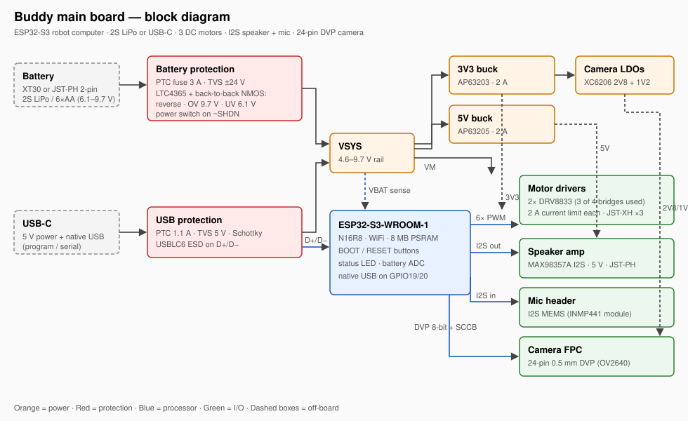
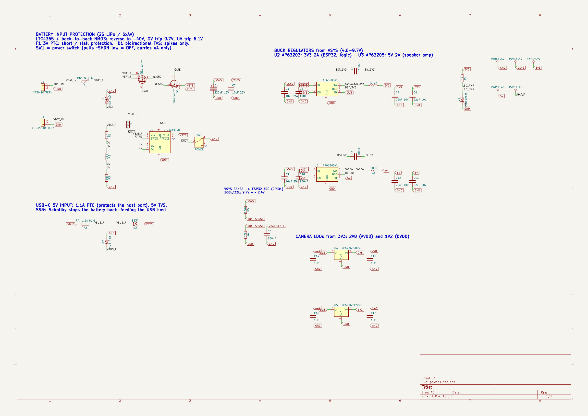
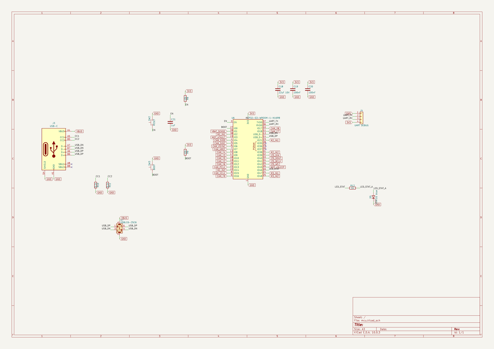
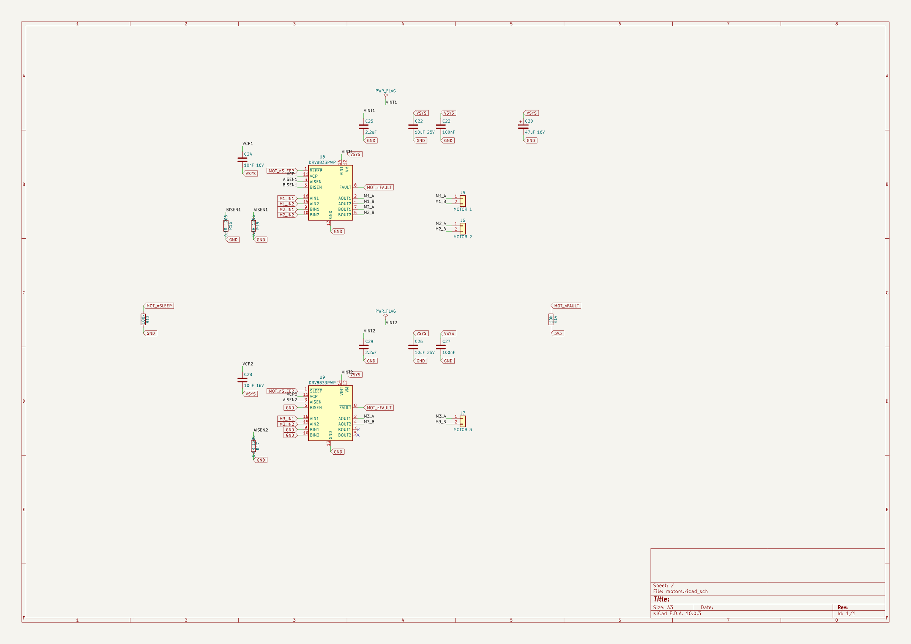
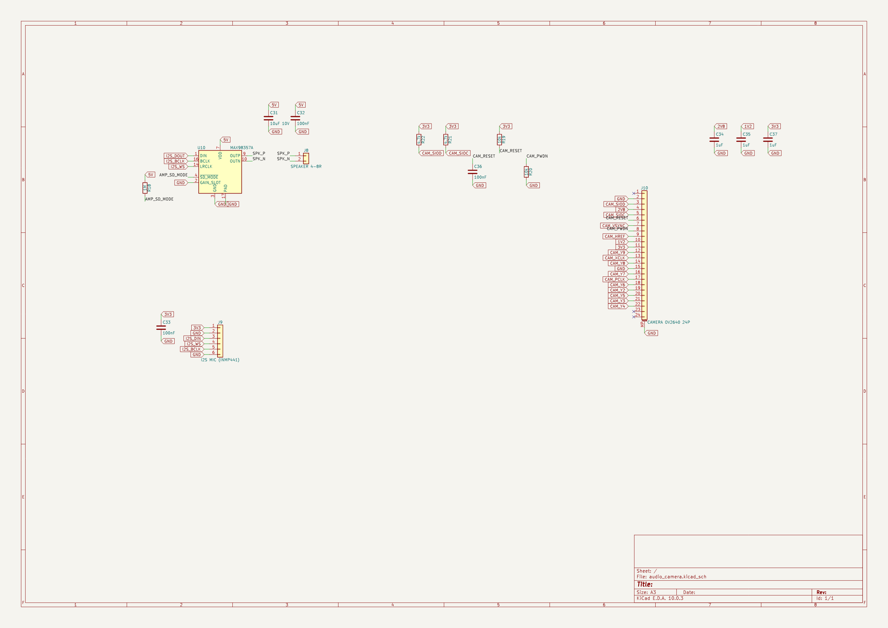
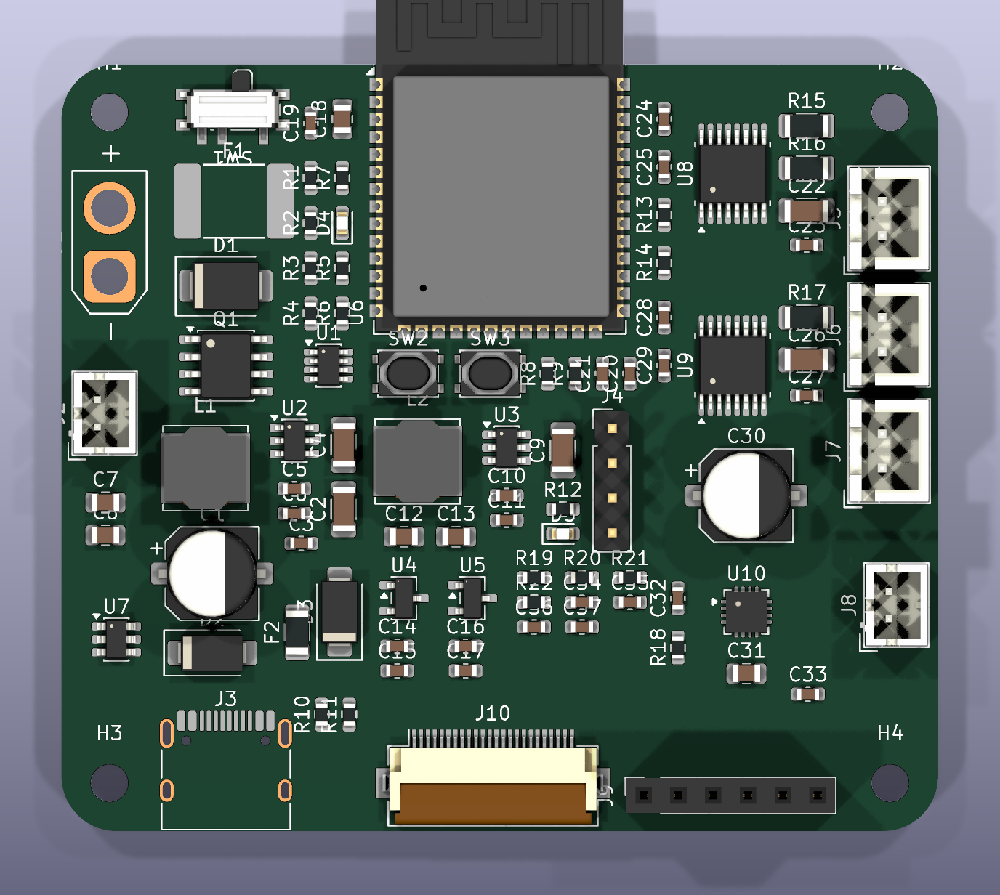
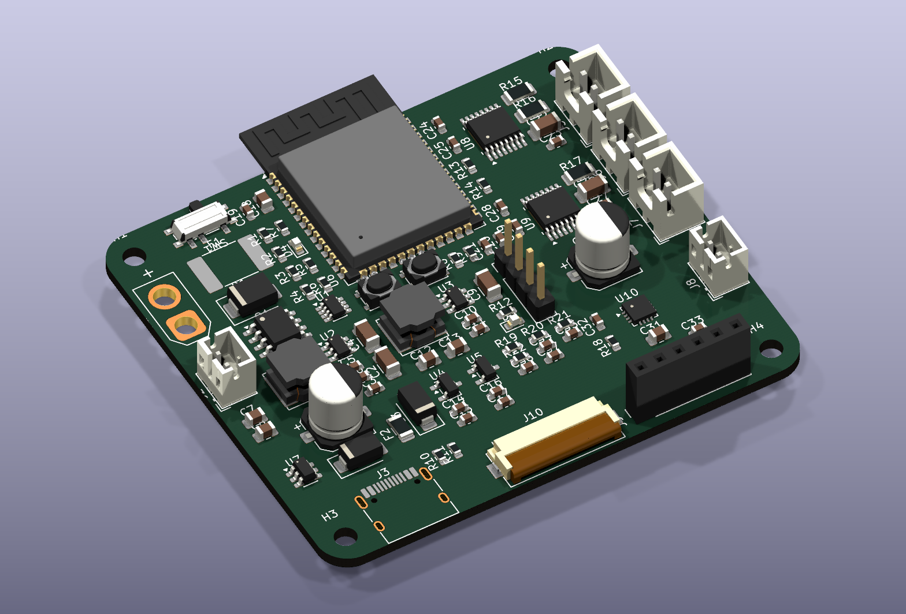
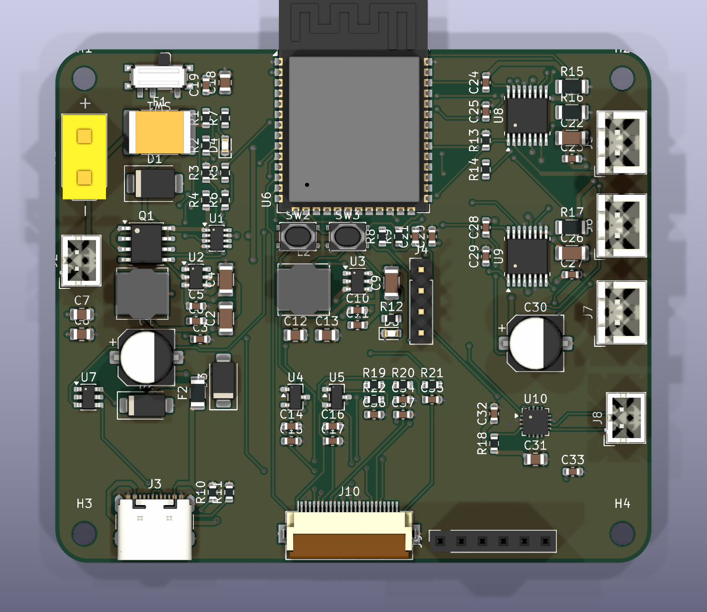
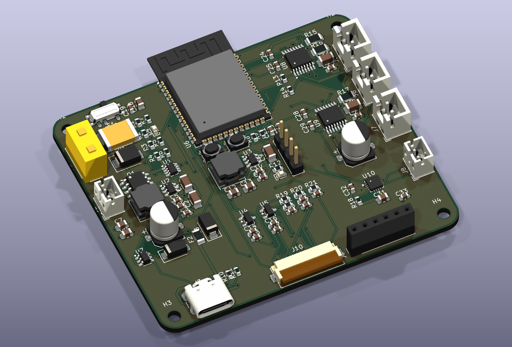
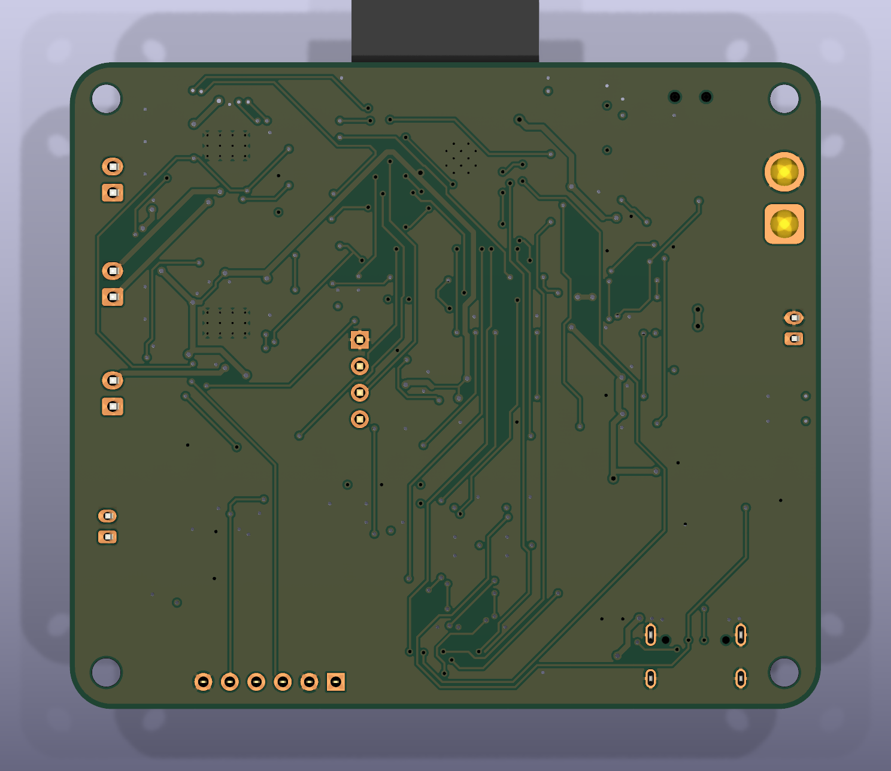

# Buddy main board: engineering notebook

A dated log of the design decisions and progress for the Buddy robot's main
PCB. The KiCad project is in `../` (`buddy_main.kicad_pro`), and the images
are in `img/`.

---

## Status at a glance (2026-11-02)

| | |
|---|---|
| **Board** | 72 × 62 mm, 4 layers (signal / GND plane / 3V3 plane / signal), 4 mm rounded corners, ESP32 antenna overhanging the top edge |
| **Schematic** | 4 hierarchical sheets, 92 parts, ERC: 0 errors (2 intentional warnings) |
| **Placement** | Done. 0 courtyard overlaps |
| **Routing** | 881 tracks and 255 vias, every trace exactly 45° or 90°. KiCad DRC: 0 errors (1 harmless thermal-relief note) |
| **Not finished** | **23 connections are still open** (listed in Entry 5), so the board **must not be ordered yet** |
| **3D models** | All 92 parts have one; two (XT30 plug, 2920 fuse) are simplified generated models |
| **Firmware** | None for this board yet. `firmware/buddy_p4` is for the ESP32-P4 and won't run on it |

**Where things are** (`hardware/buddy_main/`): `buddy_main.kicad_pro` and the
`.kicad_sch` / `.kicad_pcb` files; `3d/` (generated models); `route/` (routing
tools and logs); `backup/` (earlier board versions); `notebook/` (this file,
`bom.csv`, and `img/`).

**Contents:** Entry 1 requirements and architecture · Entry 2 schematic ·
Entry 3 compact layout · Entry 4 four layers (first routing attempts) ·
Entry 5 more room and 45°/90° routing · Entry 6 current state, bring-up plan,
open decisions · Appendix: parts list.

---

## Entry 1 · 2026-10-29 · Requirements and architecture

### Requirements 

| # | Requirement | Notes |
|---|---|---|
| R1 | One PCB acts as Buddy's main computer | Replaces the Waveshare P4-Nano dev board |
| R2 | Plug in a **speaker** | |
| R3 | Plug in a **mic** | |
| R4 | Drive **3 brushed DC motors**, no encoders | Each needs an H-bridge |
| R5 | Plug in the **camera** | |
| R6 | Power from **USB-C or a 2S LiPo** | "Easy-to-use batteries" |
| R7 | **Can't be fried** by plugging in the battery wrong | Reverse polarity, wrong battery, short |
| R8 | Designed in **KiCad**, every part with a **3D model** | |
| R9 | Progress documented in this notebook with images | |

### Block diagram



### Decision log

**D1. Processor: ESP32-S3-WROOM-1 (N16R8) module, not a bare ESP32-P4.**
- The module already contains the antenna, RF matching, 16 MB flash and
  8 MB PSRAM. The board only needs power, a reset circuit and connectors.
  It can be hand-soldered, since its pads are castellated at 1.27 mm pitch.
- A bare ESP32-P4 would need a QFN-104 package, an external core supply,
  an ESP32-C6 for WiFi, and MIPI CSI routing. That's far more risk for a
  first board.
- Trade-off: the ESP32-S3 has no MIPI CSI input, so the current OV5647
  camera can't be used. The board takes the standard **24-pin DVP
  camera** (OV2640) instead. That camera is well supported in Arduino by
  `esp32-camera`, which the original Buddy ESP32-CAM firmware already used.
- The S3 has **native USB**, so the board needs no separate USB-to-UART
  chip. Programming and serial both go over the USB-C port.

**D2. Battery input protection: LTC4365 controller + back-to-back N-MOSFETs.**
This covers R7. One small controller handles every common "plugged it in
wrong" case:

| Fault | What happens |
|---|---|
| Battery plugged in backwards | LTC4365 survives −40 V and keeps both MOSFETs off. No current flows. |
| Too-big battery (3S, 12 V supply) | Over-voltage trip at **9.7 V** turns the MOSFETs off before the motor drivers (max 10.8 V) see it |
| LiPo running flat | Under-voltage trip at **6.1 V** (≈3.05 V/cell) disconnects the load, which protects the battery |
| Short or stalled motors | 3 A PTC fuse (resettable) on the battery input |
| Voltage spikes | ±24 V bidirectional TVS. It's bidirectional so it **doesn't** conduct when the battery is reversed |

Divider for the UV/OV thresholds (both comparators trip at 0.5 V):

```
VBAT ─ R1 1 MΩ ─┬─ OV ─ R2 33 kΩ ─┬─ UV ─ R3 56 kΩ ─ GND

V_OV = 0.5 V × (R1+R2+R3)/R3        = 0.5 × 1089k/56k = 9.72 V
V_UV = 0.5 V × (R1+R2+R3)/(R2+R3)   = 0.5 × 1089k/89k = 6.12 V
Divider current at 8.4 V ≈ 7.7 µA (negligible battery drain)
```

The power switch pulls LTC4365 `~SHDN` low. It only carries microamps, so
a tiny slide switch can turn off a multi-amp battery path.

**D3. USB input protection: 1.1 A PTC + 5 V TVS + Schottky diode.**
- The PTC protects the laptop's USB port from a board fault.
- The Schottky diode stops the 7.4 V battery from pushing current back
  into the USB host when both are plugged in. When both are present, the
  higher voltage (the battery) powers the board automatically, with no
  switching logic needed.
- 5.1 kΩ resistors on CC1 and CC2 make the port identify as a 5 V sink
  (default USB-C current).

**D4. One system rail (VSYS, 4.6–9.7 V) feeds everything.**
- Motors run directly from VSYS (DRV8833 range 2.7–10.8 V, so both USB
  and 2S LiPo work).
- **3V3**: AP63203 buck converter, 2 A. A linear regulator from 8.4 V would
  burn about 2.5 W at 500 mA.
- **5V**: AP63205 buck converter, 2 A, for the speaker amp (≈3 W at 5 V vs ≈1 W
  at 3.3 V). On USB-only power it runs in dropout at about 4.3 V, which
  the amp accepts (2.5–5.5 V).
- **2V8 / 1V2**: XC6206 LDOs from 3V3 for the camera's analog and core
  supplies (milliamps, so linear regulators are fine).

**D5. Motor drivers: 2× DRV8833 dual H-bridge (3 of 4 bridges used).**
- 1.5 A RMS / 2 A peak per bridge, and both USB and 2S voltages are in range.
- 0.1 Ω sense resistors set a **2 A current limit per motor**
  (I = 0.2 V / 0.1 Ω). A stalled motor is limited, not cooked.
- `~SLEEP` is shared and pulled low, so the motors stay off until the
  firmware enables them. `~FAULT` is shared and reported to the ESP32.

**D6. Audio: MAX98357A I2S amp (speaker) + I2S MEMS mic header.**
- The amp and the mic share one I2S bus: shared BCLK and WS, data out to
  the amp, data in from the mic. That's full duplex on 4 GPIOs.
- The mic plugs in as a common INMP441 breakout module, as R3 asks.

**D7. Connectors are keyed and polarized so they can't go in backwards.**
- XT30 / JST-PH for the battery, JST-XH for the motors, JST-PH for the
  speaker, and a 24-pin FPC for the camera.

### ESP32-S3 pin map

The pins avoid the flash/PSRAM (GPIO26–37), USB (19/20), UART0 (43/44)
and the strapping pins. The few strapping pins used are only ones whose
boot level is safe.

| Function | GPIO | Notes |
|---|---|---|
| Camera Y2–Y9 | 11, 9, 8, 10, 12, 18, 17, 16 | Same as the ESP32-S3-EYE, so the stock `esp32-camera` config works |
| Camera XCLK / PCLK | 15 / 13 | |
| Camera VSYNC / HREF | 6 / 7 | |
| Camera SIOD / SIOC | 4 / 5 | 4.7 kΩ pull-ups |
| I2S BCLK / WS | 41 / 42 | Shared by amp + mic |
| I2S out (amp DIN) | 40 | |
| I2S in (mic SD) | 39 | |
| Motor 1 IN1 / IN2 | 2 / 14 | |
| Motor 2 IN1 / IN2 | 21 / 38 | |
| Motor 3 IN1 / IN2 | 47 / 48 | |
| Motor `~SLEEP` | 45 | Strapping pin. The 100 kΩ pull-down holds the required low at boot and keeps the motors asleep |
| Motor `~FAULT` | 3 | 10 kΩ pull-up (open drain) |
| Battery voltage | 1 | ADC1. 100k/33k divider: 8.4 V → 2.08 V |
| Status LED | 46 | Strapping pin. The LED to GND keeps it low at boot |
| BOOT button | 0 | |
| USB D− / D+ | 19 / 20 | Native USB-Serial/JTAG |

### Open questions / risks
- The 24-pin camera pinout varies between suppliers. I'm using the common
  OV2640 "ESP32-CAM" pinout. **Check it against your camera's datasheet
  before ordering.**
- No onboard LiPo charger. Charge the battery with a balance charger off
  the robot.

---

## Entry 2 · 2026-10-29 · Schematic captured (4 sheets), ERC clean

### Structure
The root sheet holds four hierarchical sheets. Nets that cross sheets use
**global labels** (GND, VSYS, 3V3, 5V, 2V8, 1V2, VBUS, VBAT_SENSE, and every
ESP32 signal). Nets that stay inside one sheet use local labels.

| Sheet | Contents | Parts |
|---|---|---|
| Power and Protection | Battery input, LTC4365 protection, USB input path, 3V3/5V bucks, camera LDOs, power LED | 47 |
| MCU and USB | ESP32-S3-WROOM-1, EN/BOOT circuit, USB-C + USBLC6 ESD, UART debug header, status LED | 16 |
| Motor Drivers | 2× DRV8833 + charge-pump/VINT caps, 0.1 Ω sense resistors, 3× JST-XH motor ports | 21 |
| Audio and Camera | MAX98357A amp + speaker JST-PH, I2S mic header, 24-pin camera FPC + pull-ups/decoupling | 16 |

### Power and Protection


### MCU and USB


### Motor Drivers


### Audio and Camera


### Component choices made while drawing
- **Si4214DDY** dual N-MOSFET (30 V, SO-8) for the back-to-back battery
  switch. Its standard dual pinout (S1 G1 S2 G2 D2 D2 D1 D1) matches the
  KiCad symbol, and LTC4365 reference designs use it.
- **0.1 Ω 1206 sense resistors**: about 0.4 W at the 2 A trip point, within
  a 0.5 W 1206 rating.
- **MAX98357A `SD_MODE`**: a 1 MΩ resistor from 5 V forms a divider with
  the internal 100 kΩ, giving ≈0.45 V. That selects (L+R)/2 mono, so it
  plays no matter which I2S slot the firmware writes. `GAIN_SLOT` on GND
  gives 12 dB of gain.
- **Camera PWDN**: tied low through 10 kΩ, so the camera is always on.
  **RESET** uses an RC to 3V3 (10 kΩ + 100 nF), so it releases after
  power-up. Neither needs a GPIO, which matters because none are free.
- **UART debug header (J4)** on TXD0/RXD0, for recovering a board whose
  firmware has crashed the USB-CDC port.

### Verification
| Check | Result |
|---|---|
| Unconnected pins, per sheet (`validate_component_connections`) | 0 on all four sheets |
| KiCad ERC (whole hierarchy) | **0 errors**, 2 warnings, both intentional and explained below |
| Netlist audit (exported `.net`, scripted) | 92 components, 91 nets, **no net with fewer than 2 pins**. Every global signal reaches both ends, e.g. `M1_IN1`: U6↔U8, `I2S_BCLK`: U6/U10/J9, `MOT_nSLEEP`: U6/U8/U9/R13 |

The two remaining ERC warnings are expected:
1. *U9 BISEN to GND*: the unused second bridge of U9 has its sense pin
   grounded, as the datasheet requires for an unused channel.
2. *U10 PAD (unspecified) to GND*: the amp's exposed thermal pad is meant
   to be grounded.

One real ERC finding was fixed: the DRV8833 library symbol types `VINT`
as a power **input**, but it's the chip's internal 5 V regulator output,
which only needs a 2.2 µF capacitor. I added a PWR_FLAG on each VINT net,
which tells ERC the pin is self-supplied.

---

## Entry 3 · 2026-10-29 · Compact layout (64 × 56 mm, rounded corners)

### Goal
The first placement used a 95 × 70 mm rectangle and failed the placement
check: 22 courtyard overlaps, mostly from the ESP32's antenna keepout. The
request was to make the board **as small as possible** and **not a plain
square**.

### Result
| | First try | Now |
|---|---|---|
| Outline | 95 × 70 mm, square corners | **64 × 56 mm, 4 mm rounded corners** |
| Area | 6650 mm² | **3584 mm² (−46 %)** |
| Mounting holes | 4 × M3 | 4 × M2.5, tucked into the rounded corners |
| Courtyard overlaps | 22 | **0** |





Layout plot (copper, silkscreen, courtyards): [img/08_pcb_layout.svg](img/08_pcb_layout.svg)

### Decisions

**D8. ESP32 antenna overhangs the top edge.** The module footprint has a
48 mm-wide copper keepout around the antenna. Keeping it on the board
would have cost about 15 mm of board height. Espressif's hardware guide
recommends the antenna hang past the board edge, and that is also the best
case for WiFi range. So the module origin sits 6.75 mm below the top edge:
every pad is on the board, and the antenna and its whole keepout are off
it. **The enclosure must leave the antenna tip clear of metal.**

**D9. Smaller footprints where the electrical spec allowed it.**

| Ref | Before | After | Why it's still OK |
|---|---|---|---|
| J1 | XT30PW horizontal (14 × 16 mm) | **XT30U vertical** (11 × 6 mm) | Same XT30 plug, standing upright |
| SW2/SW3 | TL3342 (8.5 × 6 mm) | **PTS810** (5.7 × 3.7 mm) | RESET/BOOT are only pressed occasionally |
| C1 | 470 µF 8 × 10.5 | **100 µF 16 V 6.3 × 7.7** | C30 adds 47 µF of motor bulk beside the drivers, and 20 µF+ ceramic sits at each buck input |

**D10. Floor plan follows the ESP32 pinout** to keep 2-layer routing
possible:
- **Left:** battery input and protection (XT30 / JST-PH on the left edge,
  power switch on the top edge), 3V3 buck, bulk cap, and the USB-C input
  path with its ESD near the connector.
- **Under the module:** RESET/BOOT, EN/BOOT pull-ups, the 5V buck
  (near the amp it feeds), UART header, status LED, and the camera
  LDOs and pull-ups, right above the camera FPC.
- **Right:** both DRV8833s, each with its sense resistors and charge-pump
  caps, feeding the three motor JST-XH connectors on the right edge.
  The speaker amp and speaker connector are below them, on the side of the
  module with the I2S pins (IO39–42).
- **Bottom edge:** USB-C, the camera FPC (cable leaves the board edge),
  and the mic socket.

**D11. Design rules set to JLCPCB 2-layer limits.** The TSOT-23-8
(LTC4365) has 0.15 mm pad gaps, and the module and DRV8833 thermal pads use
0.2 mm vias, so the old 0.2 mm clearance / 0.3 mm hole defaults flagged
the footprints themselves.

| Rule | Value |
|---|---|
| Default netclass | 0.15 mm clearance, 0.2 mm track, 0.6/0.3 mm via |
| `Power` netclass (VSYS, battery, VBUS, 5V, motor outputs) | 0.5 mm track, 0.8/0.4 mm via |
| Minimum hole | 0.2 mm |

### How it was checked
- A script read every footprint's real courtyard from the KiCad library,
  rotated it, and checked all 92 parts for overlaps and for fit inside
  the rounded outline *before* anything was moved in KiCad. The ESP32
  only counted its on-board part. Result: 0 problems.
- KiCad DRC afterwards:

| Check | Result |
|---|---|
| Courtyard overlap, keepout, clearance, hole size | **0 errors** |
| Unrouted connections | 252, expected because nothing is routed yet |
| Schematic parity | 8 notes: 4 mounting holes are board-only, and 4 swapped parts have an empty "Description" field. Both are harmless |
| Warnings | Silkscreen overlap and "differs from library" warnings only, cleaned up after routing |

### 3D models
Every one of the 92 parts has a 3D model, and a script confirms that every
model file exists. Getting there took some digging. Five footprints point
at model files that **don't exist in KiCad's official 3D library**
(checked against `gitlab.com/kicad/libraries/kicad-packages3D`, master,
2026-10-29):

| Ref | Part | Fix |
|---|---|---|
| J3 | HRO TYPE-C-31-M-12 USB-C | **Swapped to GCT USB4105-xx-A**: same 16 pad names, same size, official model |
| J1 | AMASS XT30U-M | Own simplified model, `3d/AMASS_XT30U-M_1x02_P5.0mm_Vertical.step` |
| F1 | 2920 PTC fuse | Own simplified model, `3d/Fuse_2920_7451Metric.step` |
| U8, U9 | DRV8833 HTSSOP-16 (mask variant) | Official model of the identical HTSSOP-16 body |
| U10 | MAX98357A TQFN-16 3×3 | Official model of the identical TQFN-16 3×3 body |

`3d/make_models.py` generates the two simplified models: coloured boxes
sized from the manufacturers' drawings, written as real STEP solids. They
are referenced via `${KIPRJMOD}/3d/`, so they travel with the project and
also appear in the STEP export.

### Next
1. Route the board. This needs Freerouting, which isn't installed yet.
   Java 17/24 already is.
2. Add GND pours on both layers and stitch them with vias.
3. Clean up silkscreen, then final DRC and fab outputs.

---

## Entry 4 · 2026-10-29 · Four layers, routing (in progress)

### Why four layers
The first routing attempts on two layers failed on the same nets: **VSYS**
and **3V3** reach almost every part, and with a 0.5 mm supply track they
couldn't be threaded between the 8 camera data lines, the USB pair and the
motor-driver pins. Freerouting stalled at about 30 unrouted connections, and
my own router managed 122 of 166 with both supply nets mostly missing.

**D12. Stackup: F.Cu signal / In1.Cu GND plane / In2.Cu 3V3 plane / B.Cu signal.**
- Every GND and 3V3 pad drops through a short 45° stub and a 0.6/0.3 mm via
  to its plane (96 vias). That removes about 70 connections from routing.
- A solid GND plane under the ESP32, the camera bus and the motor drivers
  also helps WiFi, camera signal quality and motor noise.
- Cost: a 4-layer JLCPCB order is a few dollars more for 5 boards.
- Board size and placement are unchanged.

### How it was routed
Freerouting 2.5 needs Java 25 (this PC has 24), and 2.1.0 ignored its pass
limit and ran for an hour. So I wrote a small router (`route/router.py`):
a grid A* on a 0.1 mm grid with rip-up and re-route, 45°/90° traces only, a
cost for every bend and a high cost for every via. A repair loop
(`route/repair.py`) then used **KiCad's own DRC as the judge**: it ripped up
every trace or via KiCad flagged and re-routed it with more room, until DRC
was clean. Both tools work on a *copy* of the board, because the PCB Editor
must not be edited behind its back.

| Stage | Violations | Unrouted connections |
|---|---|---|
| First grid route (any-angle traces) | 101 clearance errors | 44 |
| 45° router + via/bend costs | 41 | 28 |
| After DRC-driven repair | **0** | 20 |
| One-at-a-time finisher (keeps a result only if DRC stays clean) | **0** (one harmless thermal-relief note) | 21 |







### Status
*(Superseded by Entry 5: the board grew to 72 × 62 mm and routing improved.)*

Everything routed is **DRC-clean**. A final DRC lists **35 open ratsnest
items** that still need finishing: they sit at the tightest spots (the two
DRV8833 motor drivers, the ESP32's lower-left pins, the camera connector and
the VSYS/5V supply branches). The autorouter's cost was to leave these alone
rather than create violations. They are finished by hand in the PCB Editor.

Backups before this step are in `backup/` (2-layer, and 4-layer unrouted).

### Next
1. Hand-route the remaining open items, then fill zones (B).
2. Final DRC, silkscreen cleanup, fab outputs (Gerbers, drill, BOM, position
   file for JLCPCB).
3. New ESP32-S3 firmware for this board (OV2640 camera, I2S speaker and mic,
   DC motors). `buddy_p4.ino` is for the P4 and won't run on it.

---

## Entry 5 · 2026-10-29 · More room, 45°/90° routing, board installed

### Layout change: 64 × 56 → 72 × 62 mm
The 64 × 56 mm board left 20 or more connections that no automatic route
could fit (motor drivers, ESP32 lower pins, camera connector, supply
branches). The parts there were too tight to leave any corridor. The board
grew by 8 × 6 mm (3584 → 4464 mm², +25 %) and the crowded clusters were spread:
- 4 mm more space between the power block and the ESP32.
- Motor group (both DRV8833s, their caps and connectors) moved right and
  spread vertically; audio group moved down and right.
- Camera supplies, USB-C, camera FPC and mic socket moved down, which opens
  the corridor for the 8 camera data lines.
- Same rounded 4 mm corners; ESP32 antenna still overhangs the top edge.

### Router fixes (what actually made it work)
Each of these was a real bug, found by checking KiCad's own DRC:

| Problem | Cause | Fix |
|---|---|---|
| VSYS (supply) never routed | Other nets kept ripping it up, and it can't be re-routed once its neighbours are placed. Alone on an empty board it routes in 14 s | Route all supply nets first, then **freeze** them |
| Traces off 45°/90° (222 of 857) | Trace ends were nudged onto pad centres, tilting long traces by 1–4° | No nudging: every point sits on the 0.1 mm grid, so only 0/45/90° exist. A script checks every segment: **0 off-angle** |
| ~20 phantom "open" connections | Branches started mid-wire; KiCad only joins wires at endpoints | Branches start only on exact grid points; wires are split there; traces end well inside pads |
| Ground/3V3 open at the new board edge | Pours still covered the old outline | Pour outline updated to 72 × 62 |
| Repair loop lost routes | It ripped the supply net or half a net | Signals yield to supplies; a flagged net is ripped and re-routed whole |

### Result (installed as `buddy_main.kicad_pcb`)
| Check | Result |
|---|---|
| Board | 72 × 62 mm, 4 layers (signal / GND / 3V3 / signal) |
| Tracks / vias | 881 / 255 |
| Trace angles | all exactly 45° or 90° |
| DRC errors | **0** (one harmless thermal-relief note) |
| Open connections | **23 items** (listed below) |


**Still open (23 items):** 5V (4, the L2/C12/C13 buck output cluster), I2S_WS (2),
CAM_SIOD (2), and one each of 2V8, AISEN1, AISEN2, M1_B, BISEN1, VCP1, EN,
BOOT, I2S_DIN, CAM_PCLK, M3_IN2, UART_TX, VBUS, M3_A, SPK_N. They are the
last few spots where the router couldn't find a path without breaking a
rule, and are finished by hand.

### Notes
- Backups before this step: `backup/buddy_main_64x56_routed.kicad_pcb`,
  `backup/buddy_main_4layer_unrouted.kicad_pcb`,
  `backup/buddy_main_2layer_before_routing.kicad_pcb`.
- The routing tools (`route/router.py`, `repair.py`, `finish*.py`, `apply.py`)
  and the old 64 × 56 results (`route/old_64x56/`) are kept for reference.
- `kicad-python` is installed in `C:\Users\Gavin\Downloads\kipy-site` so the
  open PCB Editor can be edited live (`route/push_live.py`).

### Next
1. Hand-route the 23 remaining items, refill zones.
2. Final DRC, silkscreen cleanup, fab outputs (Gerbers, drill, BOM, pick-and-place).
3. ESP32-S3 firmware for this board (OV2640, I2S speaker and mic, DC motors).

---

## Entry 6 · 2026-11-02 · State check, bring-up plan, open decisions

### State of the board (checked, not assumed)
| Check | Result |
|---|---|
| File | `buddy_main.kicad_pcb`, unchanged since the Entry 5 install |
| Size / layers | 72.0 × 62.0 mm, 4 copper layers |
| Copper | 881 tracks, 255 vias, four zones (GND on both outer layers and In1, 3V3 on In2) |
| KiCad DRC | 0 errors; one `starved_thermal` note on a ground pad |
| Open connections | **23 items**, as listed in Entry 5 |
| Live editing | `kicad-python` connects to the open PCB Editor (KiCad 10.0.3) and reads the board correctly. Hand-routing of the 23 items has **not started** |

The board is therefore good for review but **not ready to fabricate**: 23
connections are unrouted, including part of the 5V buck output (L2/C12/C13),
the camera I2C and pixel clock, and three motor-driver sense/charge-pump nets.

### What is still to do, in order
1. Route the 23 open connections (hand-route in the PCB Editor, or move a part
   where a path physically doesn't exist), then refill zones and re-run DRC.
2. Silkscreen cleanup (the DRC run lists about 210 silkscreen and library
   warnings, none electrical).
3. Fab outputs: Gerbers, drill files, BOM, pick-and-place. Pick JLCPCB part
   numbers for the BOM (not assigned yet).
4. Firmware for the ESP32-S3.

### Bring-up plan (written before the first board exists)
1. **No power:** with a multimeter, check VSYS, 3V3 and 5V are not shorted to
   GND, and that the battery pins and the USB VBUS pin are not shorted to each
   other.
2. **USB only:** the green power LED (D4) should light; measure 3V3 (about
   3.3 V) and 5V. On USB alone 5V runs close to dropout, about 4.3 V, which
   the speaker amp accepts (decision D4).
3. **Battery, current-limited:** use a bench supply at 7.4 V with a low current
   limit first, then a real 2S LiPo. Protection trips at 9.72 V (over) and
   6.12 V (under), and the input survives reversed polarity down to -40 V
   (decision D2). Don't test reverse polarity on purpose with a real LiPo;
   if you want to confirm it, do it with a current-limited bench supply.
4. **Flash over USB-C** (hold BOOT, tap RESET if needed); UART header J4 is the
   backup path.
5. Peripherals one at a time: status LED, mic, speaker, camera, then each motor
   with the wheels off the ground.

### Open decisions and risks
- **Microphone:** J9 is a plug-in socket for an INMP441 module (pins: 1 3V3,
  2 GND, 3 data, 4 word-select, 5 bit-clock, 6 GND; the module's L/R pin
  goes to GND). A mic soldered on the board is possible but needs a sound hole
  through the PCB. Undecided.
- **Camera pinout:** the 24-pin connector uses the common OV2640 "ESP32-CAM"
  pinout. This has **not** been checked against the actual camera's datasheet.
  Check it before ordering.
- **No on-board charger:** charge the LiPo with a balance charger off the robot.
- **Antenna:** the ESP32 antenna sticks past the top edge. The enclosure must
  leave it clear of metal and the battery.
- **Generated 3D models:** J1 (XT30) and F1 (2920 fuse) use simple box models
  from `3d/make_models.py`. Good for fit checks, not for pictures.
- **Motor current:** each DRV8833 bridge is limited to 2 A by the 0.1 Ω sense
  resistors. Stalled motors are limited, not protected from heating, so use
  motors that can take 2 A.

### Related work outside this board: robot firmware lag
The Buddy robot running on the Waveshare ESP32-P4 board was slow, with a laggy
camera and a mic and speaker that seemed dead. Video, mic, speaker and drive
commands share one websocket through a phone hotspot to a cloud server, and
the 448 × 448 video I had set earlier (quality 70, 15 fps) most likely
flooded the link. Changes to `firmware/buddy_p4/buddy_p4.ino`:
- Video now defaults to 320 × 320, quality 55, up to 12 fps.
- Only one video frame is in flight; frames are skipped (not even encoded)
  while the last one is still sending.
- The frame rate slows itself down when sends take long, so audio and drive
  commands get through.
- A status line every 3 s: `[net] video fps, KB/s, send ms/frame, gap, wifi dBm`.
- `AEC_LOW_COST` option for a lighter echo canceller.

This was written but **not yet tested on the robot**. The cause is a best
guess from reading the code; the `[net]` lines will confirm or rule it out.

### Lessons from the routing work
- Grid-router bugs looked like board problems. The supply net routed in 14 s
  when alone and failed only because other nets kept tearing it up; the fix was
  to route supplies first and freeze them.
- KiCad joins wires only at endpoints, so a branch that starts mid-wire counts
  as open. Everything is now split at junctions.
- Using KiCad's own DRC as the judge, and keeping a result only if DRC stayed
  clean, was what finally made the routing trustworthy.

---

## Appendix · Parts list (from `bom.csv`)

50 line items, 92 parts. Generated from the schematic with `kicad-cli sch export bom`.

| Qty | Reference | Value | Footprint |
|---|---|---|---|
| 1 | C1 | 100uF 16V | CP_Elec_6.3x7.7 |
| 5 | C2,C4,C9,C22,C26 | 10uF 25V | C_1206_3216Metric |
| 12 | C3,C5,C6,C10,C11,C19,C20,C23,C27,C32,C33,C36 | 100nF | C_0603_1608Metric |
| 5 | C7,C8,C12,C13,C18 | 22uF 10V | C_0805_2012Metric |
| 8 | C14-C17,C21,C34,C35,C37 | 1uF | C_0603_1608Metric |
| 2 | C24,C28 | 10nF 16V | C_0603_1608Metric |
| 2 | C25,C29 | 2.2uF | C_0603_1608Metric |
| 1 | C30 | 47uF 16V | CP_Elec_6.3x7.7 |
| 1 | C31 | 10uF 10V | C_0805_2012Metric |
| 1 | D1 | SMBJ24CA | D_SMB |
| 1 | D2 | SMAJ5.0A | D_SMA |
| 1 | D3 | SS34 | D_SMA |
| 1 | D4 | PWR green | LED_0603_1608Metric |
| 1 | D5 | STATUS blue | LED_0603_1608Metric |
| 1 | F1 | PTC 3A hold | Fuse_2920_7451Metric |
| 1 | F2 | PTC 1.1A hold | Fuse_1206_3216Metric |
| 1 | J1 | XT30 BATTERY | AMASS_XT30U-M_1x02_P5.0mm_Vertical |
| 1 | J2 | JST-PH BATTERY | JST_PH_B2B-PH-K_1x02_P2.00mm_Vertical |
| 1 | J3 | USB-C | USB_C_Receptacle_GCT_USB4105-xx-A_16P_TopMnt_Horizontal |
| 1 | J4 | UART DEBUG | PinHeader_1x04_P2.54mm_Vertical |
| 1 | J5 | MOTOR 1 | JST_XH_B2B-XH-A_1x02_P2.50mm_Vertical |
| 1 | J6 | MOTOR 2 | JST_XH_B2B-XH-A_1x02_P2.50mm_Vertical |
| 1 | J7 | MOTOR 3 | JST_XH_B2B-XH-A_1x02_P2.50mm_Vertical |
| 1 | J8 | SPEAKER 4-8R | JST_PH_B2B-PH-K_1x02_P2.00mm_Vertical |
| 1 | J9 | I2S MIC (INMP441) | PinSocket_1x06_P2.54mm_Vertical |
| 1 | J10 | CAMERA OV2640 24P | Hirose_FH12-24S-0.5SH_1x24-1MP_P0.50mm_Horizontal |
| 1 | L1 | 4.7uH | L_Bourns_SRN6045TA |
| 1 | L2 | 6.8uH | L_Bourns_SRN6045TA |
| 1 | Q1 | Si4214DDY | SOIC-8_3.9x4.9mm_P1.27mm |
| 2 | R1,R18 | 1M | R_0603_1608Metric |
| 2 | R2,R6 | 33k | R_0603_1608Metric |
| 1 | R3 | 56k | R_0603_1608Metric |
| 3 | R4,R5,R13 | 100k | R_0603_1608Metric |
| 2 | R7,R12 | 1k | R_0603_1608Metric |
| 5 | R8,R9,R14,R19,R20 | 10k | R_0603_1608Metric |
| 2 | R10,R11 | 5.1k | R_0603_1608Metric |
| 3 | R15-R17 | 0.1R 1206 | R_1206_3216Metric |
| 2 | R21,R22 | 4.7k | R_0603_1608Metric |
| 1 | SW1 | POWER | SW_SPDT_PCM12 |
| 1 | SW2 | RESET | SW_SPST_PTS810 |
| 1 | SW3 | BOOT | SW_SPST_PTS810 |
| 1 | U1 | LTC4365TS8 | TSOT-23-8 |
| 1 | U2 | AP63203WU | TSOT-23-6 |
| 1 | U3 | AP63205WU | TSOT-23-6 |
| 1 | U4 | XC6206P282MR | SOT-23-3 |
| 1 | U5 | XC6206P122MR | SOT-23-3 |
| 1 | U6 | ESP32-S3-WROOM-1-N16R8 | ESP32-S3-WROOM-1 |
| 1 | U7 | USBLC6-2SC6 | SOT-23-6 |
| 2 | U8,U9 | DRV8833PWP | HTSSOP-16-1EP_4.4x5mm_P0.65mm_EP3.4x5mm_Mask2.46x2.31mm_ThermalVias |
| 1 | U10 | MAX98357A | TQFN-16-1EP_3x3mm_P0.5mm_EP1.23x1.23mm |
