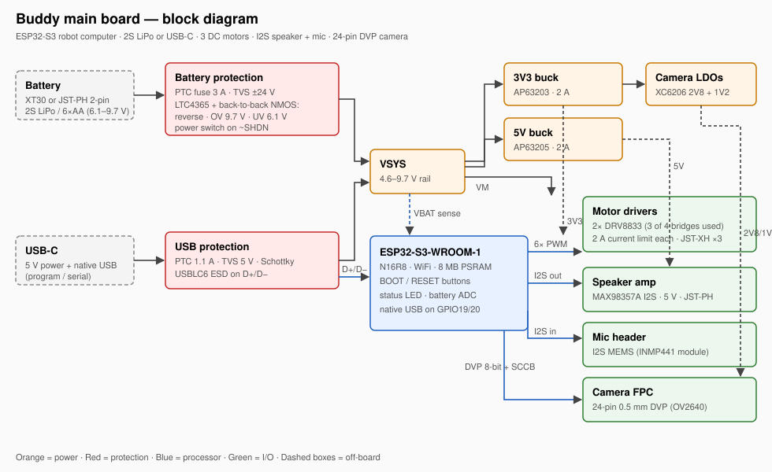
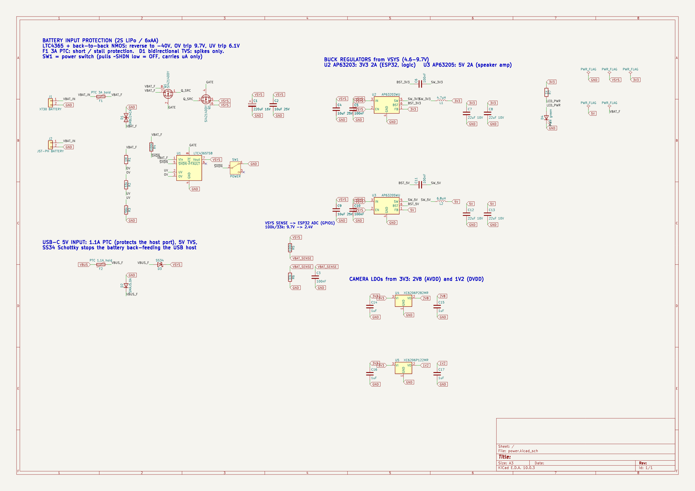
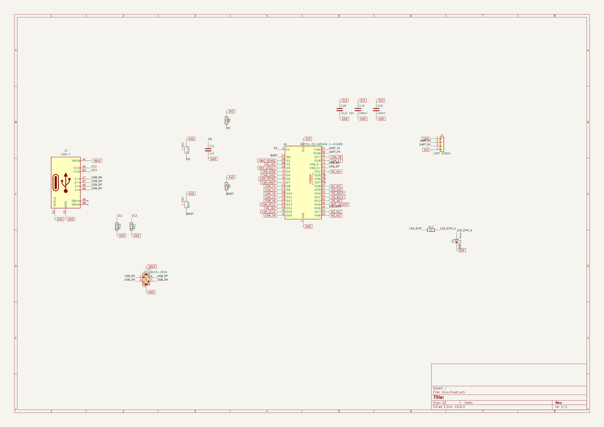
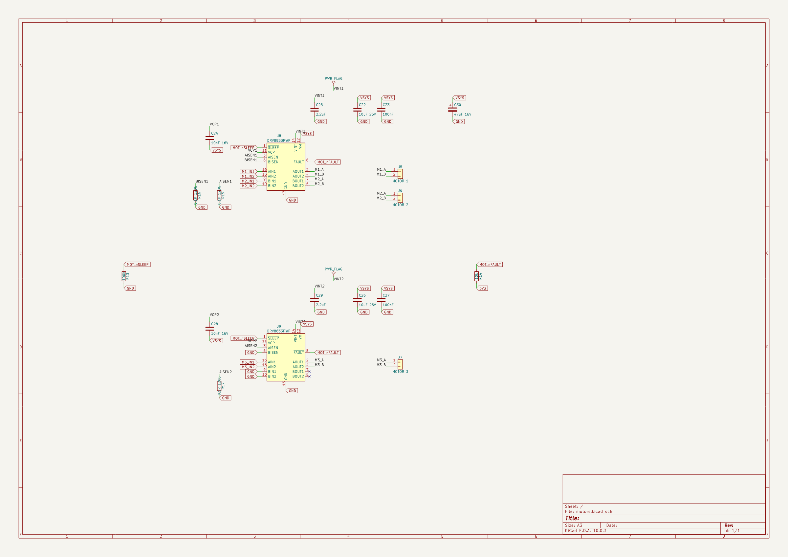
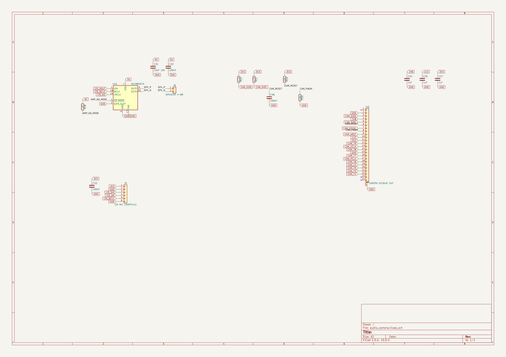
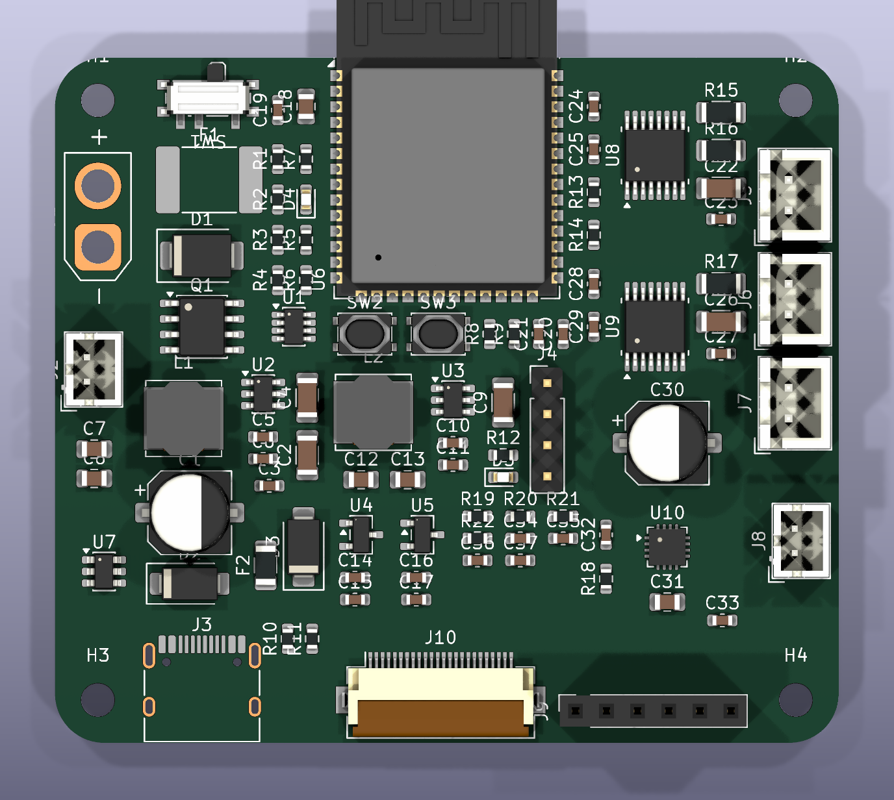
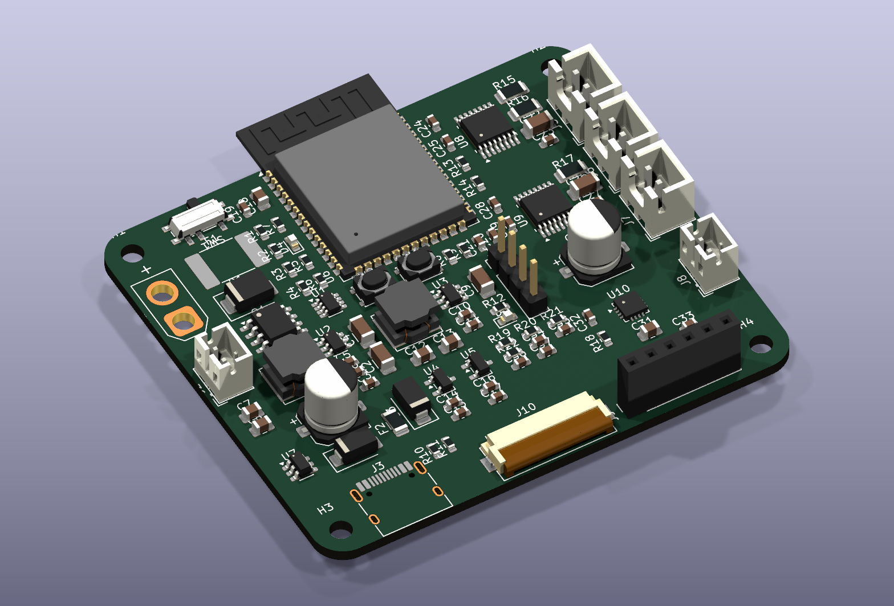

# Buddy main board: engineering notebook

A dated log of the design decisions and progress for the Buddy robot's main
PCB. The KiCad project is in `../` (`buddy_main.kicad_pro`), and the images
are in `img/`.

---

## Entry 1 · 2026-10-29 · Requirements and architecture

### Requirements 

| # | Requirement | Notes |
|---|---|---|
| R1 | One PCB acts as Buddy's main computer | Replaces the Waveshare P4-Nano dev board |
| R2 | Plug in a **speaker** | |
| R3 | Plug in a **mic** | |
| R4 | Drive **3 brushed DC motors**, no encoders | Each needs an H-bridge |
| R5 | Plug in the **camera** | |
| R6 | Power from **USB-C or a 2S LiPo** | "Easy-to-use batteries" |
| R7 | **Can't be fried** by plugging in the battery wrong | Reverse polarity, wrong battery, short |
| R8 | Designed in **KiCad**, every part with a **3D model** | |
| R9 | Progress documented in this notebook with images | |

### Block diagram



### Decision log

**D1. Processor: ESP32-S3-WROOM-1 (N16R8) module, not a bare ESP32-P4.**
- The module already contains the antenna, RF matching, 16 MB flash and
  8 MB PSRAM. The board only needs power, a reset circuit and connectors.
  It can be hand-soldered, since its pads are castellated at 1.27 mm pitch.
- A bare ESP32-P4 would need a QFN-104 package, an external core supply,
  an ESP32-C6 for WiFi, and MIPI CSI routing. That's far more risk for a
  first board.
- Trade-off: the ESP32-S3 has no MIPI CSI input, so the current OV5647
  camera can't be used. The board takes the standard **24-pin DVP
  camera** (OV2640) instead. That camera is well supported in Arduino by
  `esp32-camera`, which the original Buddy ESP32-CAM firmware already used.
- The S3 has **native USB**, so the board needs no separate USB-to-UART
  chip. Programming and serial both go over the USB-C port.

**D2. Battery input protection: LTC4365 controller + back-to-back N-MOSFETs.**
This covers R7. One small controller handles every common "plugged it in
wrong" case:

| Fault | What happens |
|---|---|
| Battery plugged in backwards | LTC4365 survives −40 V and keeps both MOSFETs off. No current flows. |
| Too-big battery (3S, 12 V supply) | Over-voltage trip at **9.7 V** turns the MOSFETs off before the motor drivers (max 10.8 V) see it |
| LiPo running flat | Under-voltage trip at **6.1 V** (≈3.05 V/cell) disconnects the load, which protects the battery |
| Short or stalled motors | 3 A PTC fuse (resettable) on the battery input |
| Voltage spikes | ±24 V bidirectional TVS. It's bidirectional so it **doesn't** conduct when the battery is reversed |

Divider for the UV/OV thresholds (both comparators trip at 0.5 V):

```
VBAT ─ R1 1 MΩ ─┬─ OV ─ R2 33 kΩ ─┬─ UV ─ R3 56 kΩ ─ GND

V_OV = 0.5 V × (R1+R2+R3)/R3        = 0.5 × 1089k/56k = 9.72 V
V_UV = 0.5 V × (R1+R2+R3)/(R2+R3)   = 0.5 × 1089k/89k = 6.12 V
Divider current at 8.4 V ≈ 7.7 µA (negligible battery drain)
```

The power switch pulls LTC4365 `~SHDN` low. It only carries microamps, so
a tiny slide switch can turn off a multi-amp battery path.

**D3. USB input protection: 1.1 A PTC + 5 V TVS + Schottky diode.**
- The PTC protects the laptop's USB port from a board fault.
- The Schottky diode stops the 7.4 V battery from pushing current back
  into the USB host when both are plugged in. When both are present, the
  higher voltage (the battery) powers the board automatically, with no
  switching logic needed.
- 5.1 kΩ resistors on CC1 and CC2 make the port identify as a 5 V sink
  (default USB-C current).

**D4. One system rail (VSYS, 4.6–9.7 V) feeds everything.**
- Motors run directly from VSYS (DRV8833 range 2.7–10.8 V, so both USB
  and 2S LiPo work).
- **3V3**: AP63203 buck converter, 2 A. A linear regulator from 8.4 V would
  burn about 2.5 W at 500 mA.
- **5V**: AP63205 buck converter, 2 A, for the speaker amp (≈3 W at 5 V vs ≈1 W
  at 3.3 V). On USB-only power it runs in dropout at about 4.3 V, which
  the amp accepts (2.5–5.5 V).
- **2V8 / 1V2**: XC6206 LDOs from 3V3 for the camera's analog and core
  supplies (milliamps, so linear regulators are fine).

**D5. Motor drivers: 2× DRV8833 dual H-bridge (3 of 4 bridges used).**
- 1.5 A RMS / 2 A peak per bridge, and both USB and 2S voltages are in range.
- 0.1 Ω sense resistors set a **2 A current limit per motor**
  (I = 0.2 V / 0.1 Ω). A stalled motor is limited, not cooked.
- `~SLEEP` is shared and pulled low, so the motors stay off until the
  firmware enables them. `~FAULT` is shared and reported to the ESP32.

**D6. Audio: MAX98357A I2S amp (speaker) + I2S MEMS mic header.**
- The amp and the mic share one I2S bus: shared BCLK and WS, data out to
  the amp, data in from the mic. That's full duplex on 4 GPIOs.
- The mic plugs in as a common INMP441 breakout module, as R3 asks.

**D7. Connectors are keyed and polarized so they can't go in backwards.**
- XT30 / JST-PH for the battery, JST-XH for the motors, JST-PH for the
  speaker, and a 24-pin FPC for the camera.

### ESP32-S3 pin map

The pins avoid the flash/PSRAM (GPIO26–37), USB (19/20), UART0 (43/44)
and the strapping pins. The few strapping pins used are only ones whose
boot level is safe.

| Function | GPIO | Notes |
|---|---|---|
| Camera Y2–Y9 | 11, 9, 8, 10, 12, 18, 17, 16 | Same as the ESP32-S3-EYE, so the stock `esp32-camera` config works |
| Camera XCLK / PCLK | 15 / 13 | |
| Camera VSYNC / HREF | 6 / 7 | |
| Camera SIOD / SIOC | 4 / 5 | 4.7 kΩ pull-ups |
| I2S BCLK / WS | 41 / 42 | Shared by amp + mic |
| I2S out (amp DIN) | 40 | |
| I2S in (mic SD) | 39 | |
| Motor 1 IN1 / IN2 | 2 / 14 | |
| Motor 2 IN1 / IN2 | 21 / 38 | |
| Motor 3 IN1 / IN2 | 47 / 48 | |
| Motor `~SLEEP` | 45 | Strapping pin. The 100 kΩ pull-down holds the required low at boot and keeps the motors asleep |
| Motor `~FAULT` | 3 | 10 kΩ pull-up (open drain) |
| Battery voltage | 1 | ADC1. 100k/33k divider: 8.4 V → 2.08 V |
| Status LED | 46 | Strapping pin. The LED to GND keeps it low at boot |
| BOOT button | 0 | |
| USB D− / D+ | 19 / 20 | Native USB-Serial/JTAG |

### Open questions / risks
- The 24-pin camera pinout varies between suppliers. I'm using the common
  OV2640 "ESP32-CAM" pinout. **Check it against your camera's datasheet
  before ordering.**
- No onboard LiPo charger. Charge the battery with a balance charger off
  the robot.

---

## Entry 2 · 2026-10-29 · Schematic captured (4 sheets), ERC clean

### Structure
The root sheet holds four hierarchical sheets. Nets that cross sheets use
**global labels** (GND, VSYS, 3V3, 5V, 2V8, 1V2, VBUS, VBAT_SENSE, and every
ESP32 signal). Nets that stay inside one sheet use local labels.

| Sheet | Contents | Parts |
|---|---|---|
| Power and Protection | Battery input, LTC4365 protection, USB input path, 3V3/5V bucks, camera LDOs, power LED | 47 |
| MCU and USB | ESP32-S3-WROOM-1, EN/BOOT circuit, USB-C + USBLC6 ESD, UART debug header, status LED | 16 |
| Motor Drivers | 2× DRV8833 + charge-pump/VINT caps, 0.1 Ω sense resistors, 3× JST-XH motor ports | 21 |
| Audio and Camera | MAX98357A amp + speaker JST-PH, I2S mic header, 24-pin camera FPC + pull-ups/decoupling | 16 |

### Power and Protection


### MCU and USB


### Motor Drivers


### Audio and Camera


### Component choices made while drawing
- **Si4214DDY** dual N-MOSFET (30 V, SO-8) for the back-to-back battery
  switch. Its standard dual pinout (S1 G1 S2 G2 D2 D2 D1 D1) matches the
  KiCad symbol, and LTC4365 reference designs use it.
- **0.1 Ω 1206 sense resistors**: about 0.4 W at the 2 A trip point, within
  a 0.5 W 1206 rating.
- **MAX98357A `SD_MODE`**: a 1 MΩ resistor from 5 V forms a divider with
  the internal 100 kΩ, giving ≈0.45 V. That selects (L+R)/2 mono, so it
  plays no matter which I2S slot the firmware writes. `GAIN_SLOT` on GND
  gives 12 dB of gain.
- **Camera PWDN**: tied low through 10 kΩ, so the camera is always on.
  **RESET** uses an RC to 3V3 (10 kΩ + 100 nF), so it releases after
  power-up. Neither needs a GPIO, which matters because none are free.
- **UART debug header (J4)** on TXD0/RXD0, for recovering a board whose
  firmware has crashed the USB-CDC port.

### Verification
| Check | Result |
|---|---|
| Unconnected pins, per sheet (`validate_component_connections`) | 0 on all four sheets |
| KiCad ERC (whole hierarchy) | **0 errors**, 2 warnings, both intentional and explained below |
| Netlist audit (exported `.net`, scripted) | 92 components, 91 nets, **no net with fewer than 2 pins**. Every global signal reaches both ends, e.g. `M1_IN1`: U6↔U8, `I2S_BCLK`: U6/U10/J9, `MOT_nSLEEP`: U6/U8/U9/R13 |

The two remaining ERC warnings are expected:
1. *U9 BISEN to GND*: the unused second bridge of U9 has its sense pin
   grounded, as the datasheet requires for an unused channel.
2. *U10 PAD (unspecified) to GND*: the amp's exposed thermal pad is meant
   to be grounded.

One real ERC finding was fixed: the DRV8833 library symbol types `VINT`
as a power **input**, but it's the chip's internal 5 V regulator output,
which only needs a 2.2 µF capacitor. I added a PWR_FLAG on each VINT net,
which tells ERC the pin is self-supplied.

---

## Entry 3 · 2026-10-29 · Compact layout (64 × 56 mm, rounded corners)

### Goal
The first placement used a 95 × 70 mm rectangle and failed the placement
check: 22 courtyard overlaps, mostly from the ESP32's antenna keepout. The
request was to make the board **as small as possible** and **not a plain
square**.

### Result
| | First try | Now |
|---|---|---|
| Outline | 95 × 70 mm, square corners | **64 × 56 mm, 4 mm rounded corners** |
| Area | 6650 mm² | **3584 mm² (−46 %)** |
| Mounting holes | 4 × M3 | 4 × M2.5, tucked into the rounded corners |
| Courtyard overlaps | 22 | **0** |





Layout plot (copper, silkscreen, courtyards): [img/08_pcb_layout.svg](img/08_pcb_layout.svg)

### Decisions

**D8. ESP32 antenna overhangs the top edge.** The module footprint has a
48 mm-wide copper keepout around the antenna. Keeping it on the board
would have cost about 15 mm of board height. Espressif's hardware guide
recommends the antenna hang past the board edge, and that is also the best
case for WiFi range. So the module origin sits 6.75 mm below the top edge:
every pad is on the board, and the antenna and its whole keepout are off
it. **The enclosure must leave the antenna tip clear of metal.**

**D9. Smaller footprints where the electrical spec allowed it.**

| Ref | Before | After | Why it's still OK |
|---|---|---|---|
| J1 | XT30PW horizontal (14 × 16 mm) | **XT30U vertical** (11 × 6 mm) | Same XT30 plug, standing upright |
| SW2/SW3 | TL3342 (8.5 × 6 mm) | **PTS810** (5.7 × 3.7 mm) | RESET/BOOT are only pressed occasionally |
| C1 | 470 µF 8 × 10.5 | **100 µF 16 V 6.3 × 7.7** | C30 adds 47 µF of motor bulk beside the drivers, and 20 µF+ ceramic sits at each buck input |

**D10. Floor plan follows the ESP32 pinout** to keep 2-layer routing
possible:
- **Left:** battery input and protection (XT30 / JST-PH on the left edge,
  power switch on the top edge), 3V3 buck, bulk cap, and the USB-C input
  path with its ESD near the connector.
- **Under the module:** RESET/BOOT, EN/BOOT pull-ups, the 5V buck
  (near the amp it feeds), UART header, status LED, and the camera
  LDOs and pull-ups, right above the camera FPC.
- **Right:** both DRV8833s, each with its sense resistors and charge-pump
  caps, feeding the three motor JST-XH connectors on the right edge.
  The speaker amp and speaker connector are below them, on the side of the
  module with the I2S pins (IO39–42).
- **Bottom edge:** USB-C, the camera FPC (cable leaves the board edge),
  and the mic socket.

**D11. Design rules set to JLCPCB 2-layer limits.** The TSOT-23-8
(LTC4365) has 0.15 mm pad gaps, and the module and DRV8833 thermal pads use
0.2 mm vias, so the old 0.2 mm clearance / 0.3 mm hole defaults flagged
the footprints themselves.

| Rule | Value |
|---|---|
| Default netclass | 0.15 mm clearance, 0.2 mm track, 0.6/0.3 mm via |
| `Power` netclass (VSYS, battery, VBUS, 5V, motor outputs) | 0.5 mm track, 0.8/0.4 mm via |
| Minimum hole | 0.2 mm |

### How it was checked
- A script read every footprint's real courtyard from the KiCad library,
  rotated it, and checked all 92 parts for overlaps and for fit inside
  the rounded outline *before* anything was moved in KiCad. The ESP32
  only counted its on-board part. Result: 0 problems.
- KiCad DRC afterwards:

| Check | Result |
|---|---|
| Courtyard overlap, keepout, clearance, hole size | **0 errors** |
| Unrouted connections | 252, expected because nothing is routed yet |
| Schematic parity | 8 notes: 4 mounting holes are board-only, and 4 swapped parts have an empty "Description" field. Both are harmless |
| Warnings | Silkscreen overlap and "differs from library" warnings only, cleaned up after routing |

### 3D models
Every one of the 92 parts has a 3D model, and a script confirms that every
model file exists. Getting there took some digging. Five footprints point
at model files that **don't exist in KiCad's official 3D library**
(checked against `gitlab.com/kicad/libraries/kicad-packages3D`, master,
2026-10-29):

| Ref | Part | Fix |
|---|---|---|
| J3 | HRO TYPE-C-31-M-12 USB-C | **Swapped to GCT USB4105-xx-A**: same 16 pad names, same size, official model |
| J1 | AMASS XT30U-M | Own simplified model, `3d/AMASS_XT30U-M_1x02_P5.0mm_Vertical.step` |
| F1 | 2920 PTC fuse | Own simplified model, `3d/Fuse_2920_7451Metric.step` |
| U8, U9 | DRV8833 HTSSOP-16 (mask variant) | Official model of the identical HTSSOP-16 body |
| U10 | MAX98357A TQFN-16 3×3 | Official model of the identical TQFN-16 3×3 body |

`3d/make_models.py` generates the two simplified models: coloured boxes
sized from the manufacturers' drawings, written as real STEP solids. They
are referenced via `${KIPRJMOD}/3d/`, so they travel with the project and
also appear in the STEP export.

### Next
1. Route the board. This needs Freerouting, which isn't installed yet.
   Java 17/24 already is.
2. Add GND pours on both layers and stitch them with vias.
3. Clean up silkscreen, then final DRC and fab outputs.
